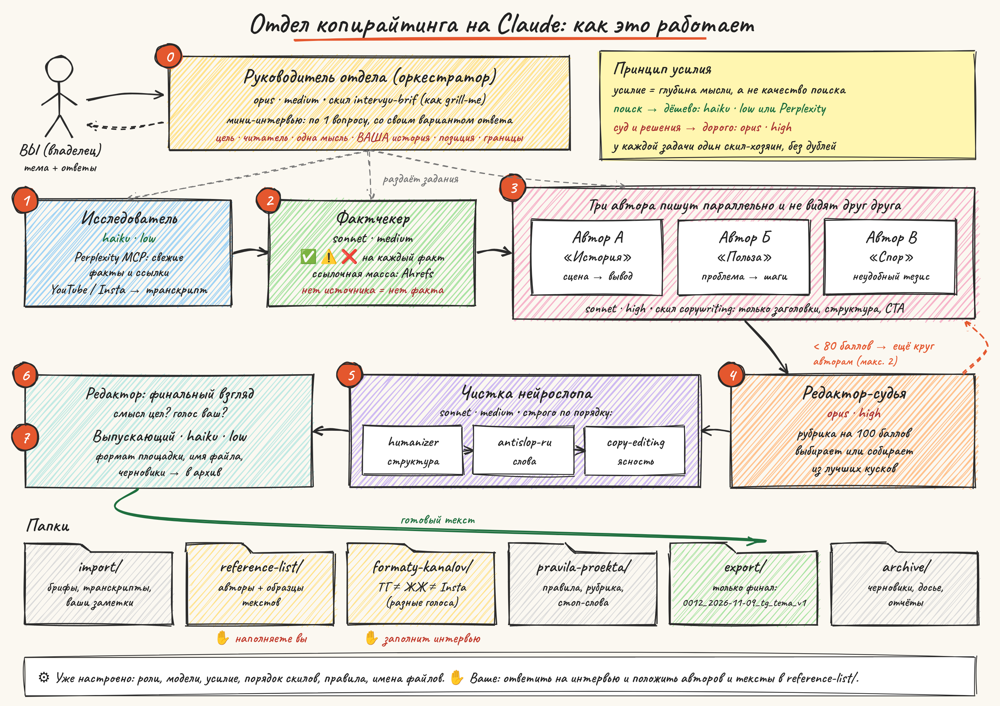

# Отдел копирайтинга на Claude: схема и инструкция

## Что это
Не «один ИИ-копирайтер», а маленькая редакция из ИИ-агентов. У каждого своя роль, своя модель и свой уровень усилия. Руководитель отдела сначала расспрашивает вас, потом раздаёт работу, а редактор выбирает лучшее из трёх черновиков. Получается ваш личный Добби, который пишет вашим голосом и под каждую площадку по-своему.

Вся структура уже настроена: роли, модели, правила, порядок скилов, имена файлов. От вас нужно две вещи: **ответить на интервью** и **собрать свою библиотеку референсов**.

## Как проходит один текст

**0. Мини-интервью (всегда).** Руководитель отдела задаёт вопросы по одному и к каждому предлагает свой вариант ответа: можно просто сказать «да». Он не отпустит задачу дальше, пока не поймёт цель, читателя, главную мысль, вашу личную историю или опыт, вашу позицию, площадку и запреты. Это как скил grill-me, только под тексты. Именно здесь появляется то, чего нет у других ИИ-текстов: вы.

**1. Исследователь** ищет свежие факты, цифры и ссылки через Perplexity и расшифровывает видео с YouTube и Instagram, если вы их дали. Работает на дешёвой модели с низким усилием: для поиска глубокое мышление не нужно.

**2. Фактчекер** ставит каждому факту ✅, ⚠️ или ❌. Без источника факт в текст не попадает. Для SEO-статей дополнительно проверяет ссылки и ссылочную массу через Ahrefs.

**3. Три автора** пишут параллельно и не видят друг друга. Угол у каждого свой: А начинает с истории, Б с пользы, В со спора. У каждого есть ваша площадка, ваши референсы и ваши слова из интервью.

**4. Редактор-судья** (самая сильная модель) ставит баллы по рубрике из 100 пунктов. Он берёт лучшую версию или собирает текст из сильных кусков. Если все версии ниже 80 баллов, черновики уходят авторам на новый круг, максимум два раза.

**5. Чистка нейрослопа** идёт строго по порядку: humanizer убирает ИИ-структуру, antislop-ru чистит русские штампы и канцелярит, copy-editing добавляет ясности и конкретики. Каждый скил делает только свою часть, чтобы они не правили одно и то же по-разному.

**6. Редактор** проверяет ещё раз: смысл не потерялся, голос ваш.

**7. Выпускающий** оформляет текст под площадку, называет файл и кладёт его в `export/`. Черновики уходят в `archive/`.

## Модели и усилие: главный принцип
| Роль | Модель · усилие | Почему |
|---|---|---|
| Руководитель | opus · medium | понять человека, но не думать часами |
| Исследователь | haiku · low + Perplexity | качество поиска определяет поисковик, а не глубина мысли |
| Фактчекер | sonnet · medium | сопоставить источники |
| Авторы ×3 | sonnet · high | текст состоит из сотни мелких решений |
| Редактор | opus · high | главное суждение, на нём не экономим |
| Антислоп | sonnet · medium | работа по чек-листу |
| Выпускающий | haiku · low | механика |

## Скилы и MCP
| Что | Зачем | Шаг |
|---|---|---|
| intervyu-brif (свой, по мотивам grill-me) | интервью перед текстом | 0 |
| transkribaciya (свой) | YouTube, Instagram, подкасты → текст | 1 |
| copywriting ([coreyhaines31/marketingskills](https://github.com/coreyhaines31/marketingskills)) | **только** заголовки, структура, CTA | 3 |
| humanizer ([blader/humanizer](https://github.com/blader/humanizer)) | **только** структурные признаки ИИ | 5 |
| antislop-ru (свой) | русский нейрослоп и канцелярит | 5 |
| copy-editing (marketingskills) | **только** ясность, конкретика, доказательства | 5 |
| Perplexity MCP | актуальный поиск со ссылками | 1, 2 |
| YouTube Transcript MCP | субтитры без скачивания | 1 |
| Ahrefs MCP | ссылочная масса (для SEO) | 2 |

Правило: у каждой задачи один скил-хозяин. Голос и тон задают только ваши референсы, никакие скилы. Ставить сверху другие «humanizer» и «brand voice» не нужно: они начнут спорить друг с другом.

## Папки
- `import/` — всё входящее: брифы, транскрипты, ваши заметки и голосовые.
- `reference-list/` — **ваша библиотека**: авторы, которые нравятся, и образцы хороших текстов с пометкой, чем они хороши. Минимум 2 автора и 5 текстов.
- `formaty-kanalov/` — правила каждой площадки. ТГ и ЖЖ — разные жанры, и отдел напишет два разных текста, а не обрежет один. Заполняется на первом интервью.
- `pravila-proekta/` — профиль, правила, рубрика, стоп-слова.
- `export/` — только финальные тексты. Имя файла: `0012_2026-11-09_tg_tema_v1.md`: номер, дата, площадка, тема, версия. Внутри шапка с баллом редактора и проверенными фактами. Пакеты сжимаются в zip.
- `archive/` — всё остальное, по папке на задачу. Ничего не удаляется.

## Инструкция: запуск
1. Распаковать архив. Открыть терминал в папке `otdel-kopiraitinga`.
2. Запустить `bash ustanovka.sh`: он поставит агентов и скилы.
3. Получить ключ Perplexity API и выполнить команду, которую покажет скрипт.
4. Запустить `claude` и написать «Привет». Руководитель отдела проведёт первое интервью: кто вы, о чём пишете, для кого и где. По ответам он заполнит профиль и форматы площадок.
5. Положить в `reference-list/` авторов и тексты, о которых он попросит.
6. Дальше просто: «Нужен пост в ТГ про …». Будет короткое интервью, потом готовый файл в `export/`.

Без терминала, на claude.ai: создать Проект, вставить `MASTER_PROMPT.md` в инструкции, загрузить папки правил, форматов и референсов в знания проекта. Это проще, но слабее: нет параллельных авторов и независимого редактора.
